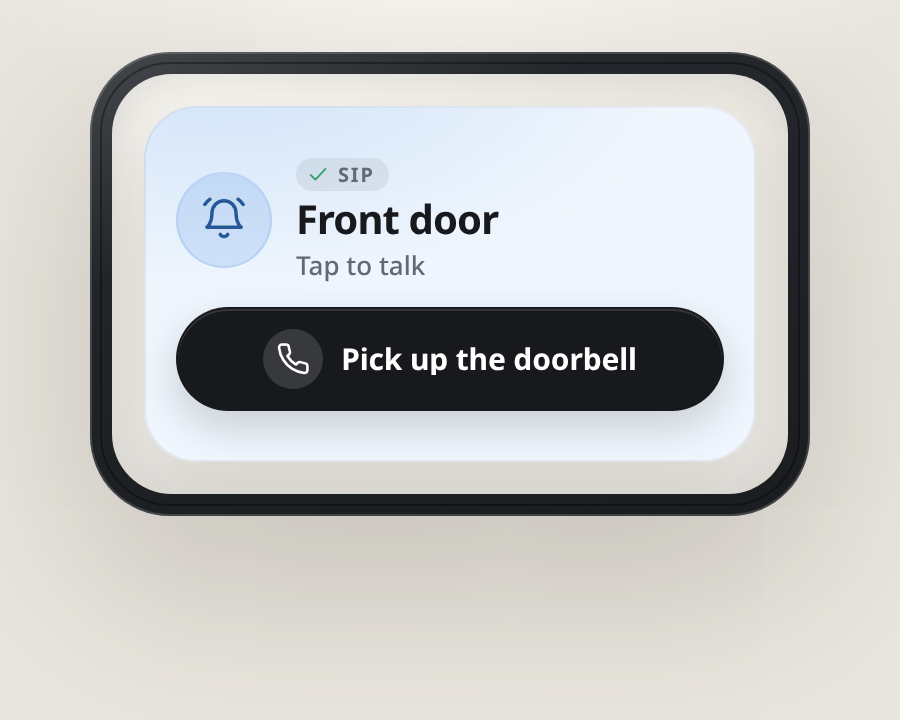
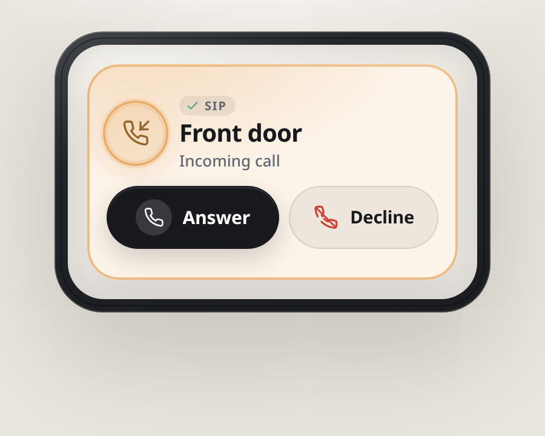
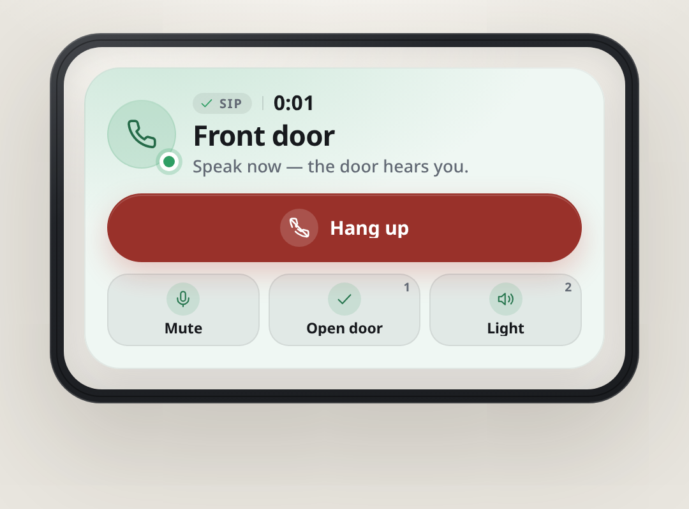
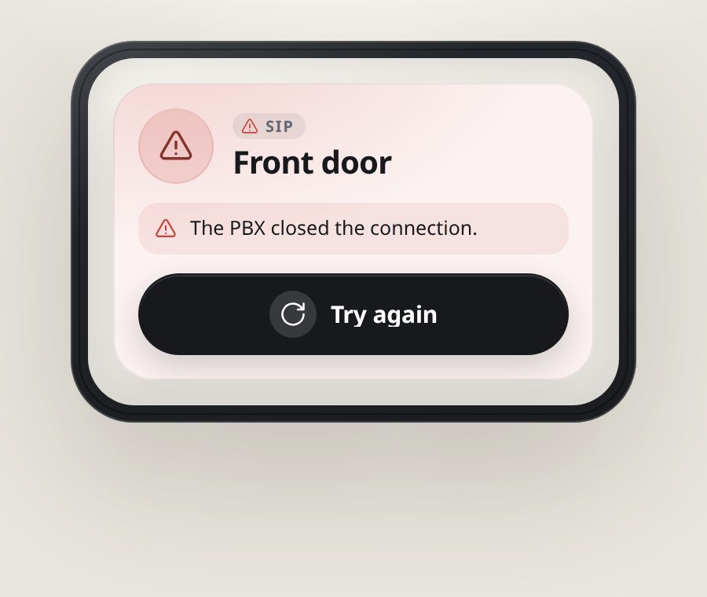
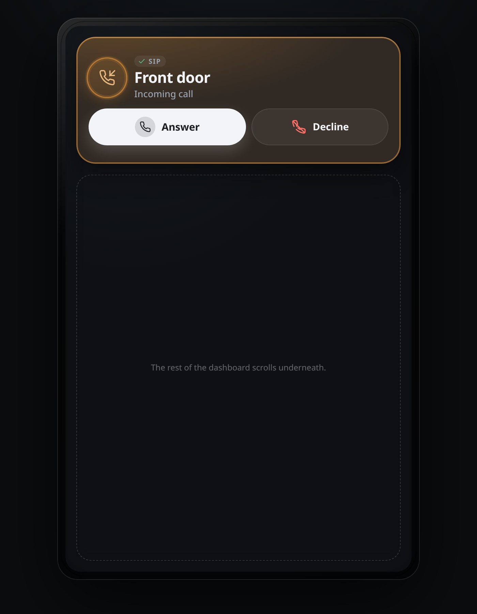
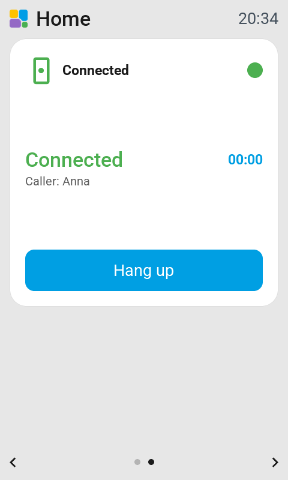

# Tessera SIP Card

[](https://github.com/Babo96/tessera-sip-card/actions/workflows/ci.yml)
[](LICENSE)

A SIP doorbell card for Home Assistant, with the calm, rounded look of a
[Tessera](https://github.com/MaxGramser/homeassistant_espscreen) tile.

It puts a real WebRTC SIP client ([SIP.js](https://sip.js.net/)) in your
dashboard: answer the door, talk, mute, send DTMF ("open door"), and hang up
without leaving Home Assistant. It is built for the
DoorPi flow — Asterisk on a Raspberry Pi, a door station on
`8000`, and a parked call picked up on `555` — but any SIP-over-WSS PBX works.

> **Status: 0.1.0 — card and companion plugin built; DoorPi call pending.**
> The SIP client has been driven through a real Asterisk (registration,
> outgoing, incoming, mute, hang up) with the local fixture in
> [`tools/asterisk/`](tools/asterisk/). The first call against the actual
> DoorPi PBX still has to be made; see [What is verified](#what-is-verified).

## Screenshots

| Idle | Ringing | Connected |
|---|---|---|
|  |  |  |

| Error, light | Ringing on a tall dark panel |
|---|---|
|  |  |

All states are driven by the demo's fake SIP client; the design does not depend
on a PBX. Every screenshot's query is listed in
[docs/screenshots/README.md](docs/screenshots/README.md). The same card against
a real Asterisk is in [docs/LIVE_TEST.md](docs/LIVE_TEST.md).

---

## The one constraint that shapes this project

Tessera runs on ESP32 boards. **SIP.js is a browser library**; a Tessera screen
cannot run it, and a Tessera plugin is C++ compiled into the screen's firmware
with no raw sockets. So there are only three honest ways to get SIP onto a
Tessera panel:

| Path | What runs where | Status here |
|---|---|---|
| **A. Browser card** (this repo) | SIP.js in a browser: HA app, wall tablet, kiosk | **Built; live-tested on a local Asterisk** |
| **B. SIP bridge in the Tessera add-on** | Asterisk ⇄ a SIP user in the add-on ⇄ the screen's existing talk stream | Designed in [docs/TESSERA.md](docs/TESSERA.md), not built |
| **C. Native SIP client in a plugin** | SIP/RTP/ICE in C++ on the ESP32 | Rejected: plugin API blocks sockets; scope is far beyond a card |

This repo contains **Path A** plus the pieces that make a Tessera screen a
useful **remote control** for it: a state helper, a command helper and an
experimental Tessera plugin tile (`tessera-plugin/`). The browser that owns the
call can be a tablet in the hallway, the HA companion app, or a kiosk. The
Tessera panel can show "Front door is calling" and trigger **Answer** on that
browser.

If you wanted the panel's own speaker and microphone to carry the call, that is
Path B — read [docs/TESSERA.md](docs/TESSERA.md) and decide before more code is
written. It is a change to the Tessera add-on, not a plugin.

---

## What it does

- **Incoming calls**: ringing state with answer/decline, optional auto-answer
  after a delay (handy for a doorbell), and a ringtone.
- **Outgoing calls**: one tap calls your pickup extension (`555` by default),
  or any target via a command helper.
- **In a call**: live timer, mute/unmute, hang up, DTMF keys you configure
  (`1` for the door, `2` for the light, …).
- **Doorbell context**: optional camera snapshot while ringing or connected.
- **Reads SIP Core's connection details**: if
  [SIP Core](https://github.com/TECH7Fox/sipcore-hass-integration) is installed
  and configured, the card takes the WSS URL, PBX and ICE servers from
  `/api/sip-core/config`; the account comes from SIP Core too unless you
  override `extension`/`password` (recommended on DoorPi, see
  [docs/DOORPI.md](docs/DOORPI.md)). Manual settings work without SIP Core.
- **Automation surface**: fires `tessera_sip_card` events (`ringing`,
  `answered`, `ended`, …), can write `input_text` state/peer helpers, and takes
  commands from a helper or an event.
- **Kiosk-aware**: one user agent per account per page, survives dashboard
  navigation, reconnects with backoff, and recovers when a hidden tab becomes
  visible again.
- **Tessera companion tile** (`tessera-plugin/`, experimental): shows phase and
  caller on the panel, offers Answer/Decline in a ringing popup, and taps
  through to the browser card.

## Requirements

- Home Assistant over **HTTPS** (WebRTC needs a secure context; `http://` on a
  LAN address will not get the microphone).
- A SIP PBX reachable over **WSS** and its **STUN/TURN** servers, e.g. DoorPi's
  Asterisk on `wss://doorpi.example:57000/ws` and coturn.
- A SIP account for the browser. **Use a dedicated extension** (for example
  `103`). This is not optional on a normal DoorPi: SIP Core's frontend module
  loads on every dashboard and registers its account (`100`) whether or not a
  SIP Core card is on the page, and DoorPi's AOR has `remove_existing=yes`, so
  the last registration kicks the other one out.
- A camera entity for the door, if you want the snapshot.

## Install

### HACS (custom repository)

1. HACS → **Dashboard** (called Frontend in older HACS) → ⋮ → **Custom repositories**.
2. Add `https://github.com/Babo96/tessera-sip-card` as **Dashboard**.
3. Install **Tessera SIP Card**, then reload the browser.

### Manual

1. Copy `dist/tessera-sip-card.js` to `/config/www/tessera-sip-card.js`.
2. Settings → Dashboards → ⋮ → **Resources** → **Add resource**:
   `/local/tessera-sip-card.js`, type **JavaScript module**.
3. Reload the browser.

The built file is committed under `dist/` so HACS can install a tag without a
build step. Do not edit it by hand; `npm run build` regenerates it.

## Configure

Recommended for DoorPi: take the WSS URL and ICE servers from SIP Core, but
give the card its **own** SIP extension (the doorbell extension in this
example):

```yaml
type: custom:tessera-sip-card
name: Haustür
use_sip_core: true            # WSS + ICE from SIP Core
extension: "103"              # a dedicated PJSIP endpoint
password: !secret doorpi_sip_card_password
call_target: "555"            # pick up the parked doorbell call
call_label: Tür abheben
camera: camera.doorpi
```

If you have no SIP Core, or you want every key explicit:

```yaml
type: custom:tessera-sip-card
name: Haustür
use_sip_core: false
wss_url: wss://doorpi.example:57000/ws
pbx_server: doorpi.example
extension: "103"
password: !secret doorpi_sip_card_password
call_target: "555"
ice_servers:
  - urls: [stun:doorpi.example:3478]
  - urls: [turns:doorpi.example:5349]
    username: doorpi
    credential: !secret doorpi_coturn_secret
```

### Options

| Key | Default | What |
|---|---|---|
| `name` | `Doorbell` | Title of the tile. |
| `subtitle` | — | Replaces the idle line ("Tap to talk"). |
| `icon` | `doorbell` | Local icon name while idle. |
| `use_sip_core` | `true` | Read the account from SIP Core. Set `false` to use only the keys below. |
| `wss_url` | SIP Core | SIP WebSocket URL, e.g. `wss://doorpi.example:57000/ws`. |
| `uri` | — | Full account URI, e.g. `sip:103@doorpi.example`. Wins over `extension`. |
| `extension` | SIP Core | SIP user to register. |
| `pbx_server` | SIP Core | SIP domain used to build URIs. |
| `auth_user` | user of `uri` | Authorization username, if it differs. |
| `password` | SIP Core | SIP password. Prefer `!secret` in YAML mode; the visual editor may store the literal value. |
| `display_name` | `name` | Display name sent with calls. |
| `call_target` | `555` | What a tap dials while idle. A bare number or a full `sip:` URI. |
| `call_label` | `Talk to the door` | Label of the main call key. |
| `auto_answer` | `false` | Accept incoming calls automatically. |
| `auto_answer_delay` | `0` | Seconds to wait before auto-answering. |
| `video` | `false` | Request video (DoorPi has none; leave off). |
| `dtmf_actions` | `[]` | Keys in a call: `[{label: Open door, digit: "1", icon: door}]`. |
| `camera` | — | `camera.*` snapshot shown while ringing/connected. |
| `ringtone` | SIP Core | Ringtone URL. |
| `id` | `tessera-sip` | Card id in events when several cards share a dashboard. |
| `event_type` | `tessera_sip_card` | Home Assistant event fired on changes. |
| `state_entity` | — | `input_text`/`input_select` to write the phase into. With `input_select`, create every phase as an option first. |
| `peer_entity` | — | Helper to write the caller into. |
| `event_entity` | — | `input_text` that gets `event\|phase\|peer\|duration\|error\|timestamp` per transition, for a non-admin kiosk. |
| `command_entity` | — | `input_text` the card watches for `answer`, `call:555`, `dtmf:1`, … |
| `clear_command` | `false` | Clear the command helper after it runs. |
| `answer_script` | — | Script/automation to run when a call connects. |
| `end_script` | — | Script/automation to run when a call ends. |
| `ice_servers` | SIP Core | WebRTC ICE servers. |
| `ice_transport_policy` | SIP Core | `all` or `relay`. |
| `language` | HA language | Force `en` or `de`. |
| `labels` | — | Override any UI string by its i18n key. |
| `debug` | `false` | SIP.js and card logging in the browser console. |

### DoorPi: which target?

DoorPi parks a door call when the button is pressed (`baresip` dials `444`,
Asterisk parks it). Two useful targets:

- **`555` — pick up the parked call.** The visitor is already waiting; audio
  starts as soon as the call connects. This is the flow in
  `doorpi/docs/ha-sip-core.md` and the default here.
- **`8000` — call the door station.** Rings the door; use it when you want to
  look/listen without a visitor having pressed the button.

If you want the card to ring on its own when someone presses the button, point
the doorpi ring automation at this extension (SIP Core can ring it) and set
`auto_answer: true` for a hands-free doorbell. Test the 45 s ring timeout and
your parking timeout against each other.

## Events and helpers

The card fires one event per transition on `event_type` (default
`tessera_sip_card`):

```json
{
  "card": "tessera-sip",
  "event": "ringing",
  "phase": "ringing",
  "peer": "8000",
  "direction": "incoming",
  "timestamp": "2026-11-23T18:00:00.000Z"
}
```

`event` is one of `registered`, `unregistered`, `ringing`, `dialing`,
`answered`, `ended`, `error`. `duration` (seconds) is present on `ended`.

> Home Assistant's `fire_event` WebSocket command requires an **admin** user.
> A non-admin kiosk still gets `state_entity`, `peer_entity` and `event_entity`;
> use `event_entity` for automations instead of the event when the dashboard
> user is not an admin.

Commands can arrive two ways:

- `command_entity` (an `input_text`): write `answer`, `decline`, `hangup`,
  `call:555`, `dtmf:1`, `mute`, `unmute`, `retry`, `enable_audio`.
- Event `${event_type}_command` (for example `tessera_sip_card_command`) with
  `{action: "call", target: "555"}` or `{action: "dtmf", digit: "1"}`.

[`examples/tessera-package.yaml`](examples/tessera-package.yaml) has the
helpers, template sensor and scripts. [`examples/lovelace-doorpi.yaml`](examples/lovelace-doorpi.yaml)
has dashboard cards.

## Tessera panel

The panel cannot carry the audio (see the table at the top), but it can be the
best doorbell annunciator in the house:

1. Install the helpers from `examples/tessera-package.yaml`.
2. Add `state_entity: input_text.tessera_sip_state`,
   `peer_entity: input_text.tessera_sip_peer` and
   `command_entity: input_text.tessera_sip_command` to the card.
3. Keep the card open on a hallway tablet or kiosk (the browser that answers).
4. Install the `tessera-plugin/` tile on the panel. It reads
   `sensor.tessera_sip` and taps through to `script.tessera_sip_toggle`.



Details, the event flow and the Path B bridge design are in
[docs/TESSERA.md](docs/TESSERA.md).

## What is verified

Automated, on every push:

- `npm run typecheck`
- `npm test` — 50 tests: state machine, view derivation, configuration, SIP URI
  building, SIP Core account selection, ingress URL, command parsing, formatting,
  and the card element with a fake client (ring → helper + event → command →
  answer, dial, target).
- `npm run build` — single ES module, SIP.js and Lit bundled.
- CI on Node 22 and 24 is green.

Done by hand in the demo (fake SIP client, no PBX):

- idle, ringing, dialing, connected, muted, ended, declined, unregistered,
  error, audio-blocked, config-error states; light and dark; narrow and wide.

Network: the DoorPi endpoint accepted a WebSocket with the `sip` subprotocol
from this machine (2026-11-23; no credentials used). Point
[`tools/check-wss.mjs`](tools/check-wss.mjs) at your own URL to reproduce it.

A **live call** was made against a local Asterisk 20 (WebSocket, `Echo()`):
registration, outgoing `555`, incoming answer, mute, timer and hang up all
worked. A PBX restart re-registered the card within about two seconds and a
call afterwards still worked. Reproduction and limits:
[docs/LIVE_TEST.md](docs/LIVE_TEST.md).

The **companion plugin** passes Tessera's `tools/check.py` and is rendered in
the Tessera preview harness; it has **not** been installed on the gang panel
(no access to the owner's Tessera app or a build/flash).

**Not yet verified**: the same against DoorPi's Asterisk 22 with a parked call,
real TLS/WSS, TURN, and a real door station. That needs the PBX password and a
browser on the LAN. The first test should be: register, call `555` with a call
parked, check two-way audio and DTMF, then hang up; repeat with a
hidden/backgrounded tab (kiosk recovery). The checklist is in
[docs/DOORPI.md](docs/DOORPI.md).

**Known limits**: one browser tab per extension (DoorPi's AOR replaces existing
contacts); no SIP video (DoorPi has none); the panel cannot carry audio in
Path A.

## Security

- The SIP password is sent to the browser by design (SIP.js needs it). WSS +
  SRTP protect the media, but anyone with the browser profile can read the
  password. Use a dedicated extension with a long password, and TURN
  credentials scoped to your coturn.
- `fetchWithAuth("/api/sip-core/config")` is authenticated, but the response
  contains the account password. Treat the dashboard as trusted.
- Never commit `secrets.yaml` or a real password to this repository. The
  examples use `!secret`.
- Prefer `ice_transport_policy: relay` on untrusted networks.

## Development

```sh
npm install
npm run dev          # demo at http://127.0.0.1:5173
npm test
npm run build
```

The demo (`demo/`) swaps in a fake SIP client via `setClientFactory()`; it does
not need Home Assistant or a PBX. For a real call without DoorPi, start the
local Asterisk fixture and open `demo/live.html`:

```sh
cd tools/asterisk && docker compose up -d
cd ../.. && npm run dev
# http://127.0.0.1:5173/demo/live.html
```

The real client is in `src/sip/client.ts`; the pure state machine is
`src/model/state.ts`; the visual seam is `src/ui/contract.ts`.

Architecture: [docs/ARCHITECTURE.md](docs/ARCHITECTURE.md). Troubleshooting:
[docs/TROUBLESHOOTING.md](docs/TROUBLESHOOTING.md). Security notes:
[docs/SECURITY.md](docs/SECURITY.md).

## Open questions (for Babo)

1. **Audio endpoint**: browser/tablet (Path A), or do you want the Tessera
   panel's own mic/speaker via an add-on SIP bridge (Path B)?
2. **Extension**: which SIP account should the browser register as (`100` is
   SIP Core's; a dedicated `103` avoids double registration)?
3. **Target**: `555` (parked pickup) or `8000` (call the door) on tap?
4. **Panel**: should the companion tile be a tile only, or also a popup with
   Answer/Decline?
5. **Publishing**: should this be submitted to HACS and/or the Tessera plugin
   index, or kept private?
6. **Plugin repository**: keep the plugin in `tessera-plugin/` (the index supports
   a path) or split it into its own repo so the Tessera app's link install sees
   the manifest at the root?
7. **Auto-pickup**: should the card dial `555` by itself when the doorbell
   event fires, or always wait for a tap?

Tracked in [issue #1](https://github.com/Babo96/tessera-sip-card/issues/1).

## Credits

- [Tessera / ESP Screens](https://github.com/MaxGramser/homeassistant_espscreen)
  by Max Gramser — the visual language and the plugin API.
- [SIP Core](https://github.com/TECH7Fox/sipcore-hass-integration) by TECH7Fox —
  the SIP account configuration the card can reuse.
- [SIP.js](https://sip.js.net/) — the browser SIP stack.
- DoorPi — the SIP doorbell this was built for.

MIT licensed.
