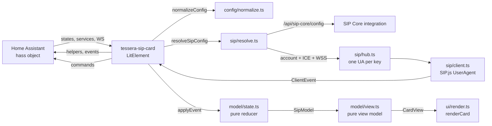

# Architecture

The repository has two independent endpoints:

1. **Native panel plugin** (`tessera-plugin/`, main path) — SIP registration,
   RTP and audio on the ESP32-P4, with a Tessera tile/card UI.
2. **Browser card** (`src/`, fallback) — SIP.js in a Home Assistant dashboard.

## Native panel plugin

```text
sip_client (vendored ESPHome component)
  ├─ UDP/WS/WSS signalling: REGISTER, INVITE, ACK, BYE, CANCEL
  ├─ SDP: PCMU/PCMA (G.711), optional DTMF telephone-event
  ├─ RTP: 20 ms packets, jitter buffer, PCM to/from the codec
  └─ mic/speaker: ts_microphone (16 kHz, post-AEC) / ts_speaker
        ▲
        │ callbacks: registered, incoming(caller), connected, ended, dtmf
        │
sip_doorbell (Tessera plugin component)
  ├─ tile: phase, peer, timer, registered dot, tap-to-call, Open key
  ├─ card: Answer/Decline/Cancel/Hangup, mute, DTMF, target/station
  ├─ popup: Answer/Decline while ringing
  └─ switches: auto answer, ring popup
```

- `plugin.yaml` creates one `sip_client` (`id: sip`) and one `sip_doorbell`
  (`id: sip_doorbell_plugin`), with callbacks wired between them.
- The plugin calls `SipClient::call/answer/hangup/send_dtmf` directly; there is
  no Home Assistant helper and no browser.
- `set_mic_muted()` zeroes PCM while RTP keeps flowing.
- The tile and card are redrawn from the native state on `on_interval`/`on_tick`.
- The component vendors eigger/espcomponents `sip_client` (MIT). Two source
  patches keep Tessera's plugin check happy (`delay` → `vTaskDelay`,
  `xTaskCreate` → `std::thread`) and add state/mute/retry accessors.

Limits: no SRTP/DTLS/ICE/TURN, plain RTP, one client/account per screen.

## Browser card

The card is deliberately small and split along one seam: everything that needs
a PBX or a browser is on one side, everything that decides what the card says is
pure and tested on the other.



## Layers

| Layer | File | Knows | Does not know |
|---|---|---|---|
| Card element | `src/card.ts` | `hass`, Lit lifecycle, events | SIP.js, how a view looks |
| Configuration | `src/config/` | YAML shape, defaults, validation | Home Assistant or SIP |
| Resolution | `src/sip/resolve.ts`, `sip-core.ts`, `uri.ts` | SIP Core config, account selection, WSS/ICE | The DOM or the UA |
| Transport | `src/sip/client.ts` | SIP.js, media, reconnection | The card's visuals |
| Shared UA | `src/sip/hub.ts` | one client per account key | Anything else |
| State | `src/model/state.ts` | transitions only | Time, audio, DOM |
| View model | `src/model/view.ts` | words, tone, actions | CSS |
| UI | `src/ui/` | structure, colour, motion | SIP, Home Assistant |

The dependency arrows only point one way. `model/` imports `config/types.ts`
for field names and nothing else. That is why 50 tests can run in ~500 ms
without a PBX, a browser or Home Assistant.

## The state machine

`Phase` is the only state the rest of the card cares about:

| Phase | Entered by | What the user can do |
|---|---|---|
| `booting` | boot, retry, registering | nothing (spinner) |
| `unregistered` | registration lost while idle | retry |
| `idle` | registered | call |
| `ringing` | incoming INVITE | answer, decline |
| `dialing` | outgoing INVITE | cancel |
| `connected` | 200 OK + ACK | mute, DTMF, hang up |
| `error` | registration failed, config/resolve error | retry |

Two rules keep it honest:

- **A live call survives registration loss.** A registration drop while
  `connected` changes `registered` but not `phase`; media can still be up.
- **A call that ends offline goes to `unregistered`, not `idle`.** The next tap
  would otherwise dial into a dead transport.

`applyEvent(model, event, now)` is pure. `now` is injected so tests can assert
timestamps. The card never writes a phase directly except through the reducer.

## Account resolution

`resolveSipConfig(cfg, hass, deps)` runs once per card. Order:

1. If `use_sip_core` (default), `GET /api/sip-core/config` with `fetchWithAuth`.
2. Pick the SIP Core user by HA user id, then by name, then `backup_user`.
3. WSS URL: card `wss_url` → SIP Core `custom_wss_url` → SIP Core ingress
   (`/api/sip-core/asterisk-ingress`) → DoorPi's default
   `wss://<pbx>:57000/ws` with a warning.
4. Account: card `uri` → card `extension` → SIP Core extension. Password: card
   `password` → SIP Core password.
5. ICE: card `ice_servers` → SIP Core `ice_config`. Video: card only.
6. Build `sip:<user>@<pbx>` and `sip:<call_target>@<pbx>`.

**One extension per user agent.** On DoorPi the SIP Core module registers its
account in every dashboard tab, and the AOR uses `remove_existing=yes`. Reading
SIP Core's config is therefore best for WSS/ICE, not for reusing its extension:
set `extension` and `password` to a dedicated endpoint. The card warns in the
console when it resolves to SIP Core's own account while SIP Core's frontend is
loaded.

The result carries a `key` of `uri|wss|authUser`. `sip/hub.ts` keeps one
`SipJsClient` per key for the page's lifetime. That is what makes navigation
safe: destroying the card does not tear down a call, and a new card created
mid-call calls `client.describe()` to replay registration and call state.

## Media

SIP.js owns the peer connection. On `Established` the client:

1. Builds a `MediaStream` from `peerConnection.getReceivers()`.
2. Attaches it to a hidden `<audio autoplay playsinline>` element appended to
   `document.body`.
3. Rebuilds it on `track` events.
4. Emits `audio-blocked` if `play()` is refused, which adds a "Tap for sound"
   key to the card.

Mute flips `MediaStreamTrack.enabled` on audio senders. DTMF prefers
`RTCRtpSender.dtmf.insertDTMF()` and falls back to a SIP INFO `dtmf-relay` body.
The Info fallback exists because Asterisk dialects differ.

## Reconnection

The client watches `RegistererState` and `UserAgent` disconnect:

- `Registered` resets the backoff.
- `Unregistered`/`Terminated`/transport close schedule `restart()` with
  exponential backoff, capped at 30 s.
- `restart()` stops the UA, clears media, and starts again with the same
  account.
- The card does not manage timers; it only shows the events.

## Home Assistant integration

The card uses only stable frontend APIs:

- `hass.states` for the camera snapshot and helper values.
- `hass.callWS({type: "fire_event"})` for `tessera_sip_card` events.
- `hass.callService()` for helpers, scripts and ringtone-adjacent actions.
- `hass.connection.subscribeEvents()` for commands, with a filter on the
  configured helper entity.

No custom integration, no backend code, no storage. `hacs.json` declares a
frontend plugin; `dist/tessera-sip-card.js` is a single ES module with SIP.js and
Lit bundled, so a resource URL is enough.

## Testability

- `tests/state.test.ts` — every transition, including the two rules above.
- `tests/view.test.ts` — the words, tones and keys of every phase.
- `tests/config.test.ts` — defaults and validation.
- `tests/resolve.test.ts` — SIP Core selection, ingress, guess, failures.
- `tests/uri.test.ts`, `tests/command.test.ts`, `tests/format.test.ts`.
- `demo/mock-client.ts` — the same UI with a fake client, driven by buttons.

The real `SipJsClient` is the only layer without a unit test; it is a thin
adapter over SIP.js. It is the first thing to check on a live PBX.

## Extension points

- **A different PBX**: `wss_url`, `pbx_server`, `ice_servers` are all card
  options; nothing assumes DoorPi except the fallback port.
- **A different UI**: replace `src/ui/render.ts` and `styles.ts`; the contract
  is `renderCard(ui, handlers)`.
- **A different transport**: implement `SipClientLike` and call
  `setClientFactory()`. The demo already does.
- **Panel audio (Path B)**: see [TESSERA.md](TESSERA.md); it belongs in the
  Tessera add-on, not here.
