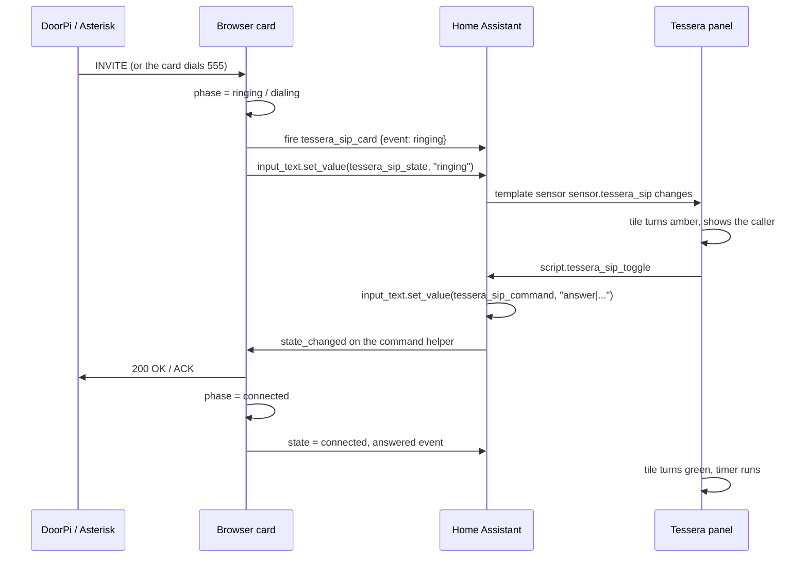

# Tessera and SIP: what can actually run where

Tessera is ESP32 firmware with LVGL. A Tessera plugin is C++ compiled into
that firmware; it runs on the screen, talks to Home Assistant through the
screen's ESPHome API, and is fenced by the plugin API. There is no browser and
no JavaScript on the glass.

SIP.js is a browser WebRTC stack. It cannot run on the panel. That is not a
missing feature; it is the shape of the two systems. Three paths follow from it.

```text
                 ┌──────────────────────────── browser ───────────────────────────┐
 DoorPi          │  HA dashboard / tablet / kiosk                                 │
 Asterisk ◄──────┼── WebRTC (WSS + SRTP) ── SIP.js ── tessera-sip-card (Path A)  │
   ▲             └────────────────────────────────────────────────────────────────┘
   │ SIP/RTP
   │             ┌──────────────────── Tessera add-on ───────────────────────────┐
   └─────────────┼── SIP gateway ── add-on call/talk plumbing ── screen (Path B)   │
                 └────────────────────────────────────────────────────────────────┘
```

## Path A — the browser card (built, live-tested locally)

What runs where:

| Piece | Where | Job |
|---|---|---|
| SIP.js user agent | Browser tab | Registration, call, media, DTMF |
| `tessera-sip-card` | Browser tab | UI, state, events, helpers |
| HA WebSocket | Browser ↔ HA | Events, commands, camera snapshot |
| Tessera panel | ESP32 | Shows state, sends commands (companion tile) |

The browser is the audio endpoint. That can be:

- a wall tablet or old phone in the hallway, always on the doorbell dashboard;
- the Home Assistant companion app on your phone;
- a kiosk browser on a small screen next to the panel.

The panel is a **remote control and annunciator**, never the audio path.

### Panel bridge protocol



The command helper is a mailbox, not a remote procedure call: the card must be
open somewhere for a command to run. If no browser holds the account, the panel
can still show "ringing" (the event → helper path does not need the card) but
"answer" does nothing audible. That is the price of Path A and the reason for
Path B.

## Path B — a SIP gateway in the Tessera add-on (designed, not built)

The Tessera add-on already carries voice both ways for calls and the doorbell:

- Screen → add-on: 16 kHz, 16-bit mono PCM in 20 ms parts, `POST
  /camera/<token>/talk` (`talk_bridge.py`, `talk_uplink.h`).
- Add-on → screen: sound parts beside the live camera's JPEGs, marked
  `X-Sound: talk`, played with a small run-up (`live_stream.py`,
  `live_view.h`).
- The add-on already holds call state, rings screens, and fires HA events
  (`calls.py`).

A SIP gateway would replace the far end of that voice path:

```text
screen mic ── 16 kHz PCM ──► add-on ── resample/encode ──► Asterisk (RTP)
screen speaker ◄─ 16 kHz PCM ── add-on ◄─ decode ──────── Asterisk (RTP)
```

### What would change

1. **A SIP user in the add-on.** `baresip` is already proven on DoorPi for the
   door station; running a second instance (or `pjsua2`, or a small Python SIP
   stack) inside the add-on's container is the lowest-risk route. It registers
   as, say, `103`, with the add-on's own credentials.
2. **A bridge module.** `talk_bridge.Voice` / `Pcm8k` already resample and
   packetise; the SIP gateway reuses those, but writes to RTP instead of a
   go2rtc backchannel. Codecs: DoorPi's PJSIP endpoints allow `ulaw,alaw`;
   G.711 at 8 kHz is the same rate the doorbell backchannel uses today.
3. **Call signalling in the add-on.** An INVITE from Asterisk becomes a
   Tessera `call` op to the chosen screen(s), reusing `calls.py`'s ring/live/
   held state. Answer/hangup map to `baresip` answer/hangup. The screen's
   existing call view and Talk key can stay as they are if the firmware accepts
   the add-on as the far end.
4. **A `sip` feature in the hello.** Negotiate it as Tessera does for other
   protocol extensions; never break the call message for older screens.
5. **Echo and level.** The panel's own canceller or the SIP peer's AEC decides
   whether the far end hears itself. DoorPi's reSpeaker already cancels on the
   door side; the panel side is the unknown. Headless audio on the add-on needs
   no sound card: it is PCM in memory.

### What is uncertain

- **The call view's peer model.** `calls.py` assumes two screens. A SIP peer is
  not a screen; the state machine needs a deliberate extension, not a hack.
- **One call per screen, 45 s ring, doorbell priority.** A SIP door call must
  fit those rules or change them with tests.
- **Latency.** Screen → add-on → RTP → Asterisk → door station adds the
  add-on's jitter buffer to DoorPi's measured path. The owner's target is under
  a second; measure before shipping.
- **Panel AEC.** Two boards in one room feed back; a SIP call's far end may be
  the same room. The existing `calls` docs already record this.
- **Add-on code review.** This is core Tessera code, not a plugin. It needs the
  Tessera project's rules, tests and release process, and the owner's approval.

Path B is the only route to "press the panel, talk through the panel". It is a
multi-week change in the add-on, not a card.

## Path C — SIP in a plugin (rejected)

A plugin cannot open a socket (`plugin.yaml` refuses `socket`, `udp`,
`packet_transport`, `http_request`), cannot run code in the add-on, and a SIP
UA needs signalling, ICE/DTLS/SRTP, jitter buffering and a codec. Even a
minimal PCMU-only UA would be a firmware-scale project, and the plugin API is
explicitly not the place for it. Rejected on purpose.

## Testing on the gang screen

The panel can test everything except audio:

1. Flash/keep a Tessera build with the plugin (through the Tessera app's
   Plugins page, or a test folder). I have not flashed or changed the panel.
2. Add the helpers from `examples/tessera-package.yaml`.
3. Open the browser card on a laptop/tablet on the same LAN, with
   `state_entity`/`peer_entity`/`command_entity` set.
4. Ring the door. Watch the panel tile change to **ringing** with the caller.
5. Tap the tile. The browser should answer (if the tab is open and registered).
6. Hang up on the browser; the panel should return to **idle**.

What this proves: the bridge, the words, the colours, the tap, the reconnect of
the sensor. What it cannot prove: audio, echo, latency, or the parked-call
pickup. Those need a browser with credentials.

## Decision record

| Date | Decision | Why |
|---|---|---|
| 2026-11-23 | Build Path A first | It is a real, testable doorbell today, and it reuses SIP Core's account without duplicating secrets. |
| 2026-11-23 | Do not put SIP in a plugin | Plugin API blocks the sockets a SIP stack needs; scope is not a tile. |
| 2026-11-23 | Keep the panel as annunciator + remote | The card already exposes phase, caller and commands; a tile is enough to test the bridge. |
| open | Path B or not | Depends on whether the owner wants the panel's own mic/speaker to carry the call. |
