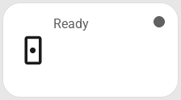
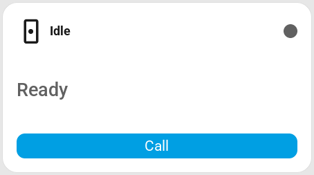
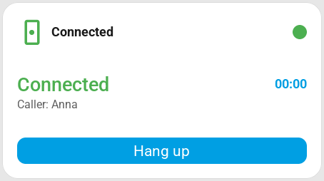
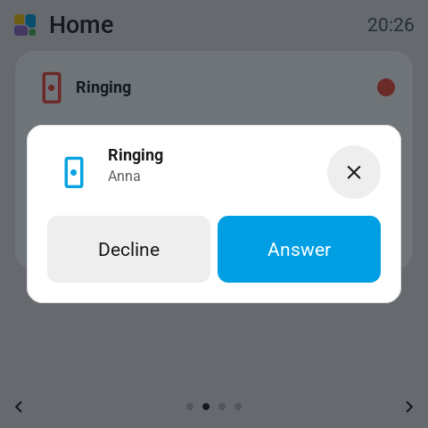

# SIP doorbell

A Tessera tile for a touch panel that shows what the SIP doorbell is doing and lets you answer or hang up. It is a
status and remote-control surface, not an audio endpoint: the SIP/WebRTC audio runs in the browser that shows the
Tessera SIP card. The tile only reads the card's phase from Home Assistant and writes the command the open card
already listens to.

## Previews

Rendered by Tessera's own preview harness on a Guition 480×480 profile; the
1x1 crop shows the short layout.

| 1×1 | 2×2 idle | 2×2 connected |
|---|---|---|
|  |  |  |

## Set up

You need the Home Assistant helpers, template sensor and scripts that come with the SIP card examples:

- `input_text.tessera_sip_state` — the phase the card writes: `booting`, `unregistered`, `idle`, `ringing`,
  `dialing`, `connected` or `error`.
- `input_text.tessera_sip_peer` — the caller, possibly empty.
- `input_text.tessera_sip_command` — what the card listens to: `answer`, `decline`, `hangup`, `call:555`,
  `dtmf:1`, `mute`, `unmute`, `retry`.
- `sensor.tessera_sip` — the template sensor the tile reads. Its state is the phase and its `peer` attribute is the
  caller.
- `script.tessera_sip_toggle` — the script a tap runs. It decides from the sensor state whether to answer, hang up or
  call.

Until it is in the Tessera plugin index, copy this `tessera-plugin/` folder to
`<ESPHome config>/tessera-plugins/sip_doorbell/` (a test folder beside your
ESPHome configuration) and add it from Tessera's **Plugins** page. The app's
link install reads a manifest at the repository root; this repository keeps
the plugin in a subfolder next to the card.

Then:

1. Add this plugin to a screen in Tessera. The screen builds once.
2. Place the **SIP doorbell** tile from the library's Plugins group.
3. In the inspector, choose `sensor.tessera_sip` as the tile's entity. If you leave it empty the tile says
   **Choose sensor**.
4. Optionally set the tile's name; **Front door** is used while it has none.

## On the screen

The tile shows a doorbell icon, the phase in words and a quiet status dot; on
tiles with room it also shows the tile name. The short CYD strip keeps only
the icon, phase and action word. While connected it counts
the time since this tile saw the call connect, on the screen's own clock. When a caller is known it shows the peer
under the phase. On taller tiles a key at the bottom says what a tap does: **Answer**, **Hang up**, **Call**,
**Retry** or **Please wait**. With a sensor chosen, a tap always runs `script.tessera_sip_toggle`.

While the phase is `ringing` the icon, phase and dot use the amber warning tone. There is no animation on the tile:
motion is kept for popups, so a tile stands still and costs no extra frames.

If **Ring popup** is on (the default), a ringing doorbell also shows a popup with **Answer** and **Decline**. They write
`answer` or `decline` to `input_text.tessera_sip_command`. The popup pulses its icon and closes when the ring ends.
The switch is a normal entity of the screen in Home Assistant and appears in the plugin's details and on the screen's
own settings page.

## Notes

- The tile has no network access, no pictures and no audio. It reads one Home Assistant entity through the plugin API
  and calls one script and one `input_text` action.
- The connected timer starts when this tile first sees `connected`; it is not the call's start time from the PBX.
- The plugin API is 0.18, the lowest that has everything used here: popups and `ui::animate` (0.18), action fields
  (0.12), `ui::set_fill` (0.9) and `set_tone` (0.8). The tile offers 1x1 to 2x2; `full: true` and `TileContext::full`
  need API 0.25 and are left out on purpose.
